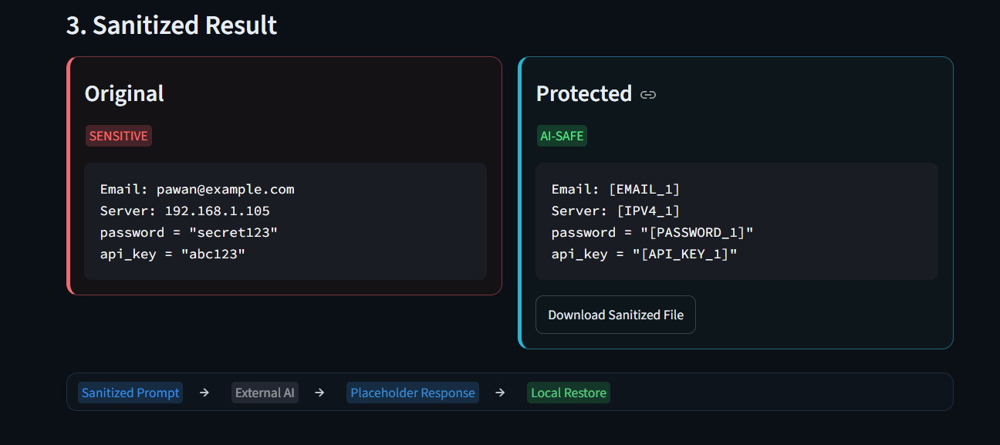
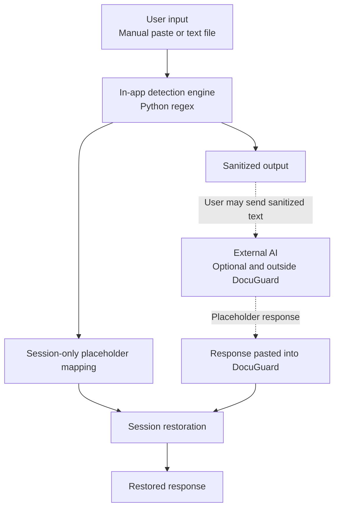
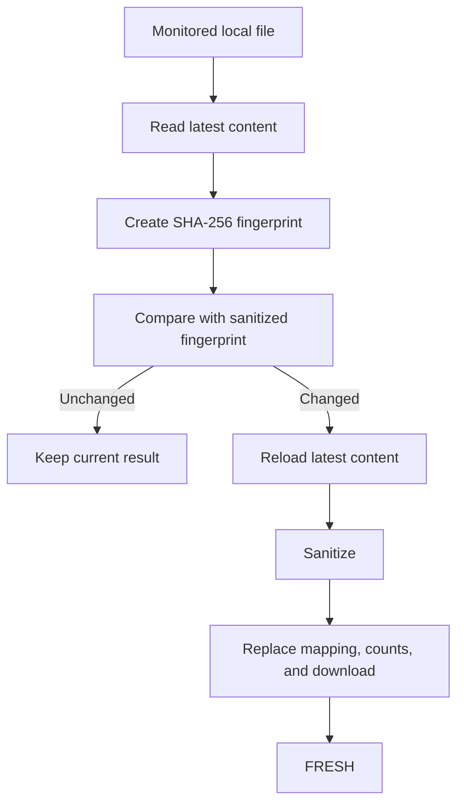

# DocuGuard

> Session-scoped sensitive data anonymization for safer AI workflows.

DocuGuard helps developers and knowledge workers sanitize sensitive information before sharing code, logs, configuration files, or text with cloud AI systems.

## Demo



## Problem

Developers often paste source code, credentials, API keys, internal IP addresses, emails, logs, and configuration data into AI assistants. This can unintentionally expose private, proprietary, or security-sensitive information.

## Solution

DocuGuard provides a session-based sanitization and restoration workflow:

**Input → Detect → Anonymize → AI-safe content → optional external AI processing → placeholder response → session restoration**

DocuGuard replaces detected values with stable placeholders before the user shares the sanitized content. If an AI response contains those placeholders, DocuGuard can restore the original values within the current Streamlit session.

DocuGuard itself does **not** call an external AI API. Sending sanitized content to an AI is a separate, user-controlled step outside the application.

## Core Features

- Email detection
- IPv4 detection with invalid-octet rejection
- Password detection
- API key, token, and secret detection
- Python/config-style credential assignments
- JSON-style credential fields
- Stable numbered placeholders
- Identical values reuse the same placeholder
- Session-scoped reversible placeholder mapping
- Session-scoped restoration of AI responses
- Manual text input
- `.txt`, `.py`, and `.json` file uploads
- 2 MB file limit
- UTF-8 and UTF-8 BOM handling
- Sanitized file download
- Explainable Privacy Report with deterministic LOW, MEDIUM, and HIGH risk levels
- Before/after comparison
- Freshness Guard for action-triggered local-file verification
- SHA-256 content fingerprinting for monitored `.txt`, `.py`, and `.json` files
- Session-only sensitive mapping
- No outbound AI/API requests made by DocuGuard

## Why DocuGuard

Many redaction tools permanently remove sensitive values. DocuGuard instead creates stable, reversible placeholders such as:

```text
[EMAIL_1]
[IPV4_1]
[PASSWORD_1]
[API_KEY_1]
```

These placeholders preserve relationships in the sanitized content. An external AI can refer to the same placeholder consistently, and DocuGuard can restore recognized placeholders in the response within the same Streamlit session afterward.

DocuGuard is a focused hackathon MVP, not a production-grade enterprise security product.

## Architecture



The external AI step is optional and is **not initiated by DocuGuard**.

## Deployment and Privacy Model

DocuGuard can run locally or on a hosted Streamlit deployment:

- Detection and substitution occur in the running Streamlit process. Locally, that process is on the user's machine; on a hosted deployment, it is on the host server.
- Placeholder mappings are held only in Streamlit session state.
- Mappings are not written to disk.
- Browser uploads are sent to the selected Streamlit deployment and processed in memory.
- Uploaded Python files are treated as text and are never executed.
- DocuGuard makes no outbound AI/API requests.

The hosted demo therefore processes pasted and uploaded content on its Streamlit server. It does not imply that browser-to-server traffic is absent or that hosted processing occurs exclusively on the visitor's device.

## Supported Input

DocuGuard accepts manually pasted text and the following text-based files:

- `.txt`
- `.py`
- `.json`

The maximum file size is **2 MB**. Files are decoded as UTF-8, including UTF-8 with a BOM, and are processed as raw text. Python is not executed, and JSON is not evaluated as application code.

## Phase 2 — Freshness Guard

The original workflow assumed that a local file had not changed since it was sanitized. During active development or interrupted work, that assumption can leave the protected output, detection counts, download, and reversible mapping out of date.

Freshness Guard adds optional local-path monitoring for `.txt`, `.py`, and `.json` files that the running Streamlit process can access. It is designed for local or self-hosted execution. The public hosted demo cannot monitor files on a visitor's computer, and browser uploads remain snapshots. Monitored files retain the existing 2 MB limit and UTF-8/UTF-8 BOM decoding rules. Python and JSON content remains raw text and is never executed or evaluated.

DocuGuard reads the latest content and compares its SHA-256 fingerprint with the fingerprint of the sanitized version. A check occurs when the user selects **Check for Changes**, before sanitization while monitoring is active, and before preparing a monitored sanitized download. If the content changed, DocuGuard reloads and sanitizes the latest version, updates the detection counts and download, replaces the previous session mapping, and returns the Current State to **FRESH**. The separate Last Event records what happened, including **File loaded and monitored**, **No changes detected**, **Change detected → latest version reprocessed**, or **Monitored file unavailable**.



Freshness Guard uses action-triggered verification rather than a filesystem watcher or continuous background polling. This avoids unnecessary disk reads, CPU overhead, Streamlit rerun instability, background race conditions, and extra dependencies. SHA-256 fingerprints are used instead of relying only on modification timestamps because a timestamp can change even when file content does not.

Missing, deleted, or unreadable monitored files become **UNAVAILABLE**, and stale protected output is suppressed or blocked as appropriate. Browser uploads remain snapshots because the browser does not provide a reusable local filesystem path.

## Example

Before:

```text
email = pawan@example.com
server = 192.168.1.105
password = "secret123"
api_key = "abc123"
```

Sanitized:

```text
email = [EMAIL_1]
server = [IPV4_1]
password = "[PASSWORD_1]"
api_key = "[API_KEY_1]"
```

Example AI response:

```text
Send the report to [EMAIL_1] after checking [IPV4_1].
```

Restored in the current session:

```text
Send the report to pawan@example.com after checking 192.168.1.105.
```

## Tech Stack

- Python
- Streamlit
- Python `re` / regular expressions
- Git / GitHub

## Installation

```bash
git clone https://github.com/pawank60025-coder/Grevix_DocuGuard.git
cd Grevix_DocuGuard
python -m venv .venv
```

Activate the virtual environment in Windows PowerShell:

```powershell
.venv\Scripts\Activate.ps1
```

Install and run:

```bash
pip install -r requirements.txt
streamlit run app.py
```

## AI-Assisted Development

AI-assisted development is permitted by the hackathon. The tools supported the development process, while the participant retained responsibility for product decisions, testing, review, and submission.

**ChatGPT**

- Architecture and prioritization
- Debugging strategy
- Judging and demo strategy
- Prompt design

**OpenAI Codex**

- Primary implementation agent inside VS Code
- Targeted bug fixes
- UI implementation

**Google Antigravity / Gemini**

- Independent code review
- Regression review
- Security and edge-case testing

**Participant**

- Selected the problem
- Made final product decisions
- Manually tested the application
- Reviewed AI-generated changes
- Maintained Git history
- Remained responsible for the final implementation

AI tools assisted with implementation and review, while the participant retained responsibility for product decisions, testing, Git history, and final submission.

## Development Strategy

The project followed three practical principles:

- **Working over complicated**
- **Finished over ambitious**
- **Demo value over hidden complexity**

Development proceeded through incremental Git commits, targeted fixes, manual validation, and independent regression review.

## Limitations

- Regex-based detection is not comprehensive PII detection.
- Triple-quoted and multiline credentials are not currently supported.
- There is no semantic Named Entity Recognition.
- PDF and DOCX parsing are not supported.
- The reversible mapping exists only during the current Streamlit session.
- There is no direct LLM integration.
- Hosted deployments process pasted and uploaded content on the host server, not exclusively on the visitor's device.
- Freshness monitoring works only when the running Streamlit process can access the specified filesystem path.
- Browser uploads are snapshots and cannot be re-read through Freshness Guard.
- Freshness checks are action-triggered; there is no continuous background monitoring or operating-system-level file watcher.
- A small theoretical interval remains between download preparation and the actual browser download click.
- DocuGuard is a hackathon MVP, not enterprise DLP or audit-grade secret-scanning software.

## Future Work

- Microsoft Presidio or spaCy-based PII detection
- PDF and DOCX support
- User-defined redaction rules
- Additional credential formats
- Automated test suite
- Packaged desktop/local application

## Hackathon

DocuGuard is being built for **Grevix AfterCode**. The project has been developed incrementally and may adapt to future Challenge Cards without claiming work that has not yet occurred.

## Team

Solo participant: **Pawan Kumar Pandey**

## Repository

https://github.com/pawank60025-coder/Grevix_DocuGuard
